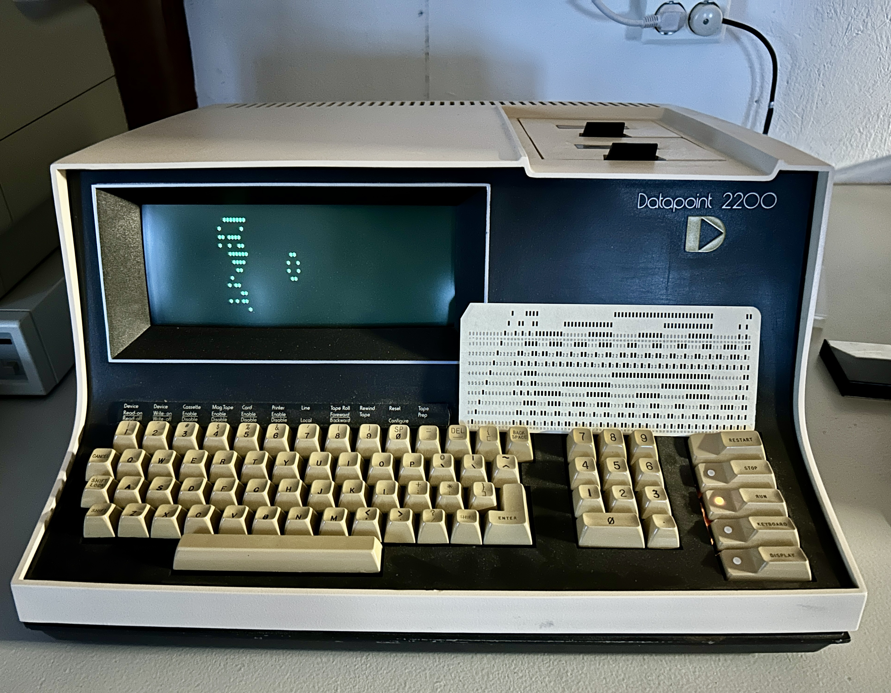
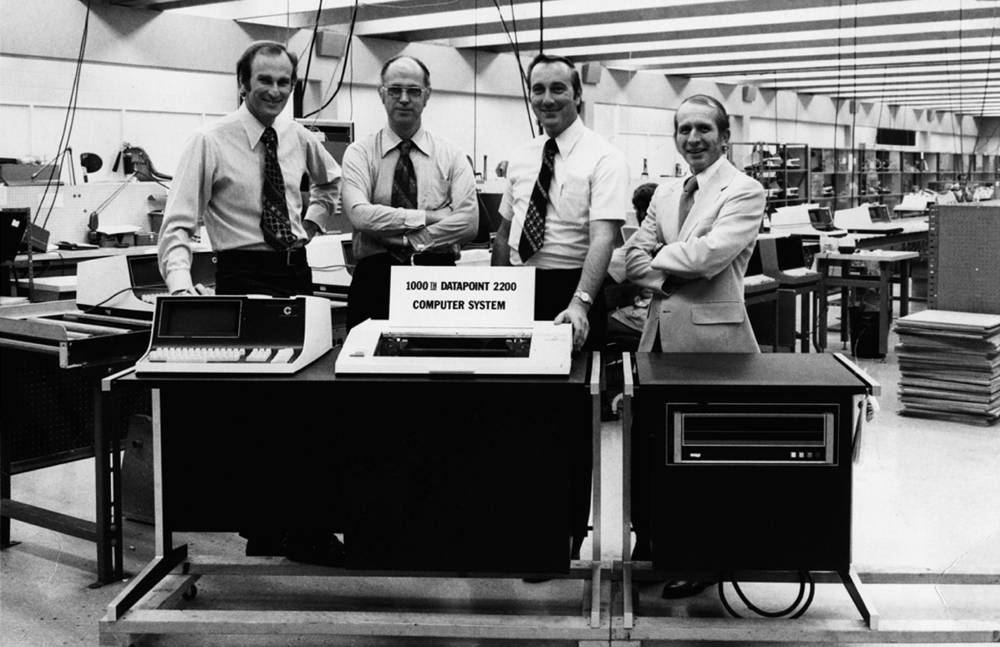

# Testing the presentation

The editable source is `presentation.qmd`. It uses Quarto + Reveal.js with the built-in dark theme and local styling in `presentation.css`. The deck loads its pictures from `Bilder/`.

## Requirements

- A web browser, such as Chrome, Firefox, or Safari.
- [Quarto](https://quarto.org/docs/get-started/) to render or preview the source. This presentation has been tested with Quarto 1.11.9.
- Python 3 only if you want to export the separate printable speaker notes.

On a new machine, install Quarto and check that `quarto --version` works in a terminal. Reveal.js is supplied by Quarto; it does not need a separate installation.

Run the commands below from the repository root. On this workstation, a local Quarto copy is also available: replace `quarto` with `build/tools/quarto/bin/quarto` if Quarto is not on your PATH. That local installation is not included in the presentation source files.

## Live preview

```sh
quarto preview presentation/presentation.qmd --host 127.0.0.1 --port 4200 --no-browser
```

Open http://localhost:4200/. Save changes to the QMD or CSS to refresh the preview. Stop the server with Ctrl+C. If an existing preview already uses port 4200, use it or choose a different port.

## Render a portable HTML file

```sh
quarto render presentation/presentation.qmd
```

Open `presentation/presentation.html` in a browser. Render mode embeds the images, styles, and presentation resources into the HTML. Preview mode can use separate resources while serving the deck; render again before copying the HTML elsewhere.

To present on another computer, copy the rendered `presentation.html` there and open it in a browser. The rendered slides work offline and do not require Quarto or Python. Use the preview server when you want live updates and speaker view.

The generated HTML and printable notes exports are excluded from Git, so render them after checking out the repository.

## Presenting and editing

- Arrow keys or Space: advance through slides.
- F: full screen. Esc: slide overview.
- S: speaker view (best used through the local preview server; allow its popup).
- For picture-only slides, separate slides with `---` on its own line. A `## Heading` can also start a slide when a visible title is wanted.
- Put speaker notes inside a `::: {.notes}` block, closed with `:::`.
- Image paths are relative to `presentation.qmd`, such as `Bilder/Datapoint2200.jpg`.

The presentation uses a 1280 × 720 dark layout, with slide numbers and automatic image stretching disabled. The museum photographs are stacked vertically. Layout helpers are described below.

Quarto documentation: https://quarto.org/docs/presentations/revealjs/

## Print speaker notes only

After editing `.notes` blocks in `presentation.qmd`, run from the repository root:

```sh
python3 presentation/scripts/export_notes.py
```

Open `presentation/speaker-notes.html` in a browser and print (Cmd+P), or choose Save as PDF. This is an A4 document with slide numbers and image filenames as reminders, without the slide pictures. Slide numbering counts the automatic title slide as slide 1. Notes for each slide stay together where possible. The generated `speaker-notes.qmd` and HTML are replaced on each export; edit your notes in `presentation.qmd`.

## Click to advance

Click anywhere in the middle 70% of the screen (including photographs) to advance. Links, media controls, text selection, and Reveal controls keep their normal behavior. This is disabled in overview, paused, speaker-notes, and PDF print views. The handler is in `click-to-advance.html`.

## Picture layouts and captions

A single photograph:

```markdown
{.slide-photo}
```

The `slide-photo` class gives the image a 680px-high frame and preserves its proportions without cropping. Add `.with-caption` to reduce the frame to 600px and leave room for text:

```markdown
{.slide-photo .with-caption}

::: {style="text-align: center; font-size: 0.45em;"}
Photo: Photographer / Source
:::
```

Use an explicit text block for attributions: ordinary figure captions are hidden by `presentation.css`. In a multi-column slide, place each attribution inside its image's column. A rotated frame is 680px high and must also be shortened if adding a caption underneath it.

For two vertically stacked pictures:

```markdown
::: {.photo-stack .centered-photo-stack}
{.museum-photo}

{.museum-photo}
:::
```

`photo-stack` gives both pictures the same width, preserves their individual proportions, and adds a 16px gap. `centered-photo-stack` centers the pair vertically within a 720px frame. The current 940px width fits the museum panoramas and schematic pair; taller images may require a narrower stack to fit.

The architecture comparison uses `.columns .architecture-comparison` for equal columns with a 24px gap. Its CPU board image is wrapped in `.rotated-photo-frame` and uses `.rotate-clockwise` for a 90° rotation. The rotation is sized to its containing frame, so it also fits inside a column. Keep nested fenced divs unambiguous: use more colons for outer containers than inner containers, as in the existing comparison slide.

## Title line breaks and speaker notes

The title uses a YAML block with Markdown hard line breaks:

```yaml
title: |
  Datapoint 2200\
  From IKEA kit to running\
  Was it the first PC?
```

Put private notes on the relevant slide, before its next separator:

```markdown
::: {.notes}
Explain the photograph and the main point of this slide.
:::

---
```

These notes appear in speaker view and the separate printable notes export, not on the projected slide. Regenerate the notes export after editing; it does not update automatically with the slide preview.
